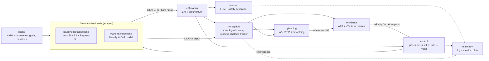
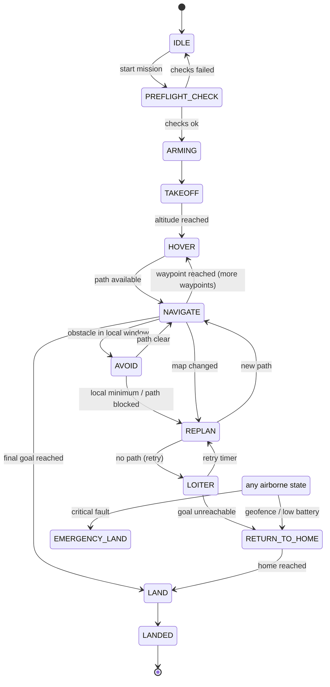

# Architecture

## 1. Guiding principles
1. **Simulator-agnostic core.** Every algorithm depends only on abstract
   interfaces and plain NumPy types. Only `dronenav.sim.isaac_pegasus` and the
   Isaac scene builder import `isaacsim` / `omni` / `pegasus`.
2. **Configuration over code.** Vehicle, controller, planner, avoidance, safety
   and scenario parameters live in YAML files, validated by typed schemas.
3. **Testability.** Every module is unit-tested in plain Python and runs in CI
   without a GPU.
4. **One frame convention end to end:** ENU world, FLU body, quaternions `[x, y, z, w]`.

## 2. Module overview

| Package | Responsibility | Phase |
|---|---|---|
| `core` | Types, frames, quaternion / SO(3) math, clock | 2 |
| `config` | pydantic schemas, YAML loading | 2 |
| `sim` | `SimBackend` interface; NumPy and Isaac/Pegasus adapters | 2–3 |
| `control` | Cascaded control loops, mixer, saturation and anti-windup | 3 |
| `estimation` | Error-state EKF (IMU, GPS, barometer, magnetometer); ground-truth mode | 4 |
| `mission` | Mission FSM, waypoints, safety supervisor | 5 |
| `scene` | Procedural scenario generation (S0–S8) | 6 |
| `perception` | Point cloud → world frame, voxel map, ray clearing, clustering + KF tracking | 7 |
| `planning` | 3D A*, RRT*, shortcutting, time-parametrised B-spline | 8 |
| `avoidance` | APF with tangential escape, velocity obstacles, local-minimum detection | 9 |
| `telemetry` | Structured logs, metrics, 3D plots, tables, video helpers | 11 |

## 3. Control loop timing (initial values, tuned in Phase 3)
| Loop | Rate |
|---|---|
| Physics (Pegasus default) | 250 Hz |
| Rate and attitude control | 250 Hz |
| Position and velocity control | 50 Hz |
| Estimator correction | GPS: sensor rate; IMU propagation: 250 Hz |
| Local avoidance | 20 Hz |
| Mapping | LiDAR rate (10–20 Hz) |
| Global (re)planning | 1–2 Hz, or on demand |

## 4. Mission state machine

The **safety supervisor** runs every control tick, independently of the FSM.
It can pre-empt the FSM on:
- a geofence breach;
- speed or altitude limits;
- an obstacle inside the emergency radius (brake and hover);
- estimator divergence;
- a mission timeout;
- simulated low battery.

## 5. Validation scenarios

| ID | Scenario | Main capability tested |
|---|---|---|
| S0 | Empty world: takeoff, hover, goal, land | control, estimation |
| S1 | Simple static obstacles (cubes, cylinders) | perception, A* |
| S2 | Wall + 6-waypoint mission | mission logic, replanning |
| S3 | Forest of poles (random density) | dense clutter |
| S4 | Narrow corridor + suspended obstacles | 3D planning, inflation |
| S5 | U-shaped trap | local-minimum handling |
| S6 | Dynamic obstacles, known trajectories | tracking, velocity obstacles |
| S7 | Random dynamic obstacles in clutter | full stack |
| S8 | Fault injection: unreachable goal, geofence, sudden obstacle, low battery, emergency | supervisor |

**Method:** each scenario runs with N = 10 random seeds.

**Metrics:**
- success or failure;
- time to goal;
- path length, and its ratio to the optimal path;
- minimum distance to obstacles;
- number of collisions;
- final positioning error;
- RMS tracking error and RMS estimation error;
- planner compute time.

**Ablations:** global-only vs local-only vs global + local, and A* vs RRT*.
